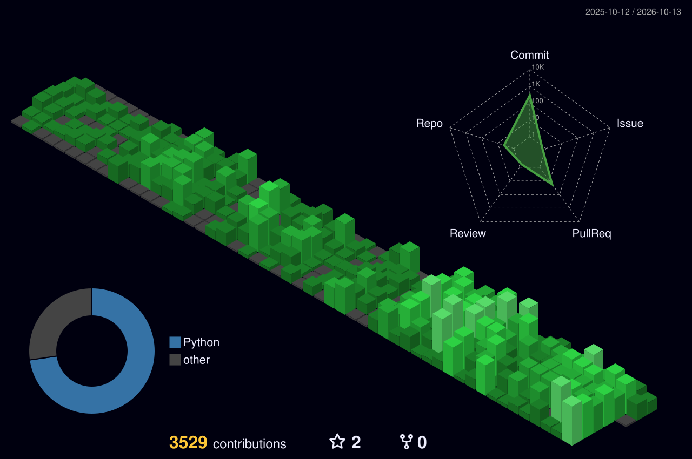

  <picture>
    <source media="(prefers-color-scheme: dark)" srcset="https://raw.githubusercontent.com/Volcann/Volcann/output/github-contribution-grid-snake-dark.svg">
    
  </picture>

  

  <i>Associate Software Engineer at Folium AI, building backend services and useful developer tools.</i>
   
  <i>Working across Django, NestJS, PostgreSQL, Redis, Celery, and React/Next.js.</i>

  

About Me
I'm Muhammad Mohsin, a software engineer based in Lahore. At Folium AI, I build backend features for client products and contribute to React/Next.js interfaces for an internal platform. I also build tools that make engineering workflows easier to run and maintain.
Work at Folium AI
- Backend services: Built Stripe subscription flows, Django Channels WebSocket notifications, and NestJS audio processing for client products.
- Client savings assistant: Built a LangGraph assistant that routes user intent to goal creation, updates, listing, and status tools so users can manage goals through chat.
- Employee review workflows: Worked on Django performance and notification services and React/Next.js review screens. The UI shows KPI criteria while keeping employee scores hidden until finalization.
Featured Projects
Aevora + Utils
- Problem: Separate local setups made developer utilities harder to share and update.
- Solution: Built authenticated Django/Next.js chat that selects relevant tools and sends PR review, status report, and workspace setup tasks to a shared Celery worker through Redis. Aevora streams chat and task events to the browser via SSE.
- Impact: Users can request these tools from one interface while their dependencies and updates stay in the shared worker.
OneDrop
- Problem: Sharing a sensitive file through a hosted service creates another stored copy.
- Solution: Built a Python HTTPS sender for direct LAN/VPN transfer with capability links, token checks, SHA-256 integrity display, and token-redacted audit logs.
- Impact: A link permits one download by default, then expires and shuts down the server.
LeanGuard
- Research focus: Exploring motorcycle blind-spot detection in CARLA with simulated radar and IMU inputs and lean-angle filtering.

🛠️ Technologies & Tools
Backend

  
  
  
  
  
  

Frontend

  
  
  
  
  

AI & Research

  
  
  
  
  
  

Infrastructure & DevOps

  
  
  

<h3 align="center">GitHub Stats </h3>

  

<h2 align="center"> 🔗 Connect With Me </h2>

  
  

  <i>Appreciate you stopping by. Always happy to connect, learn, and build meaningful things.</i>

⭐️ Fact: AI is trained on human data. That’s why it estimates a three-month sprint, even though it can build the project in three minutes

<picture>
    <source media="(prefers-color-scheme: dark)" srcset="./assets/profile-3d-contrib/profile-night-green.svg" />
    
</picture>

